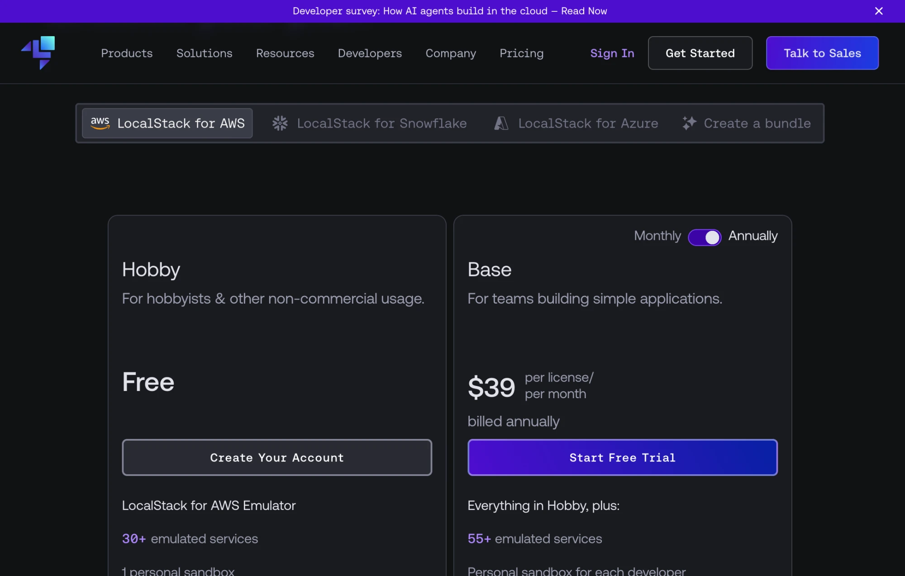
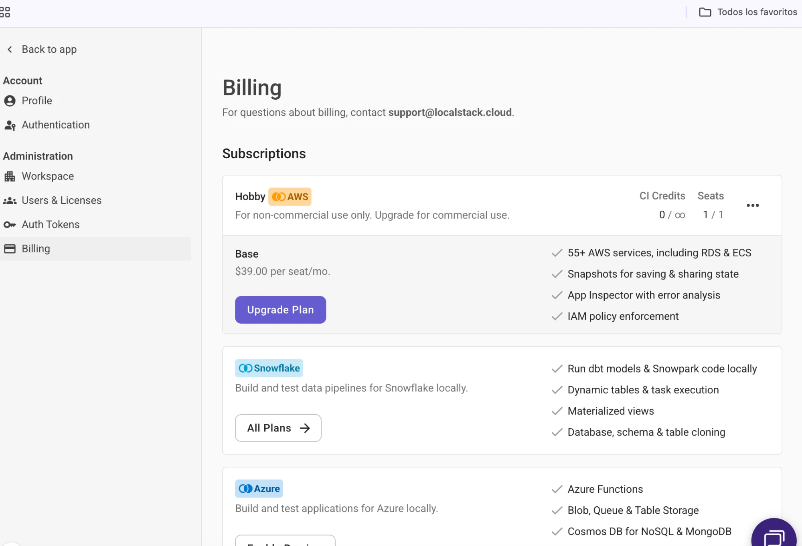
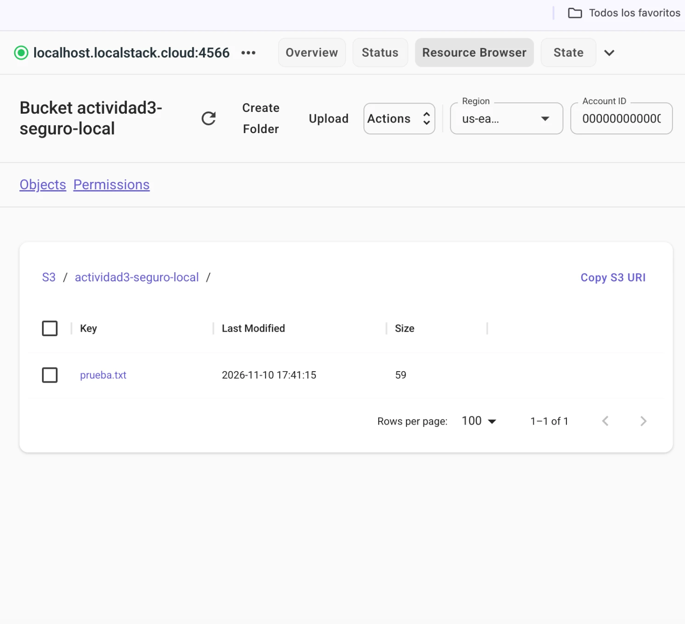
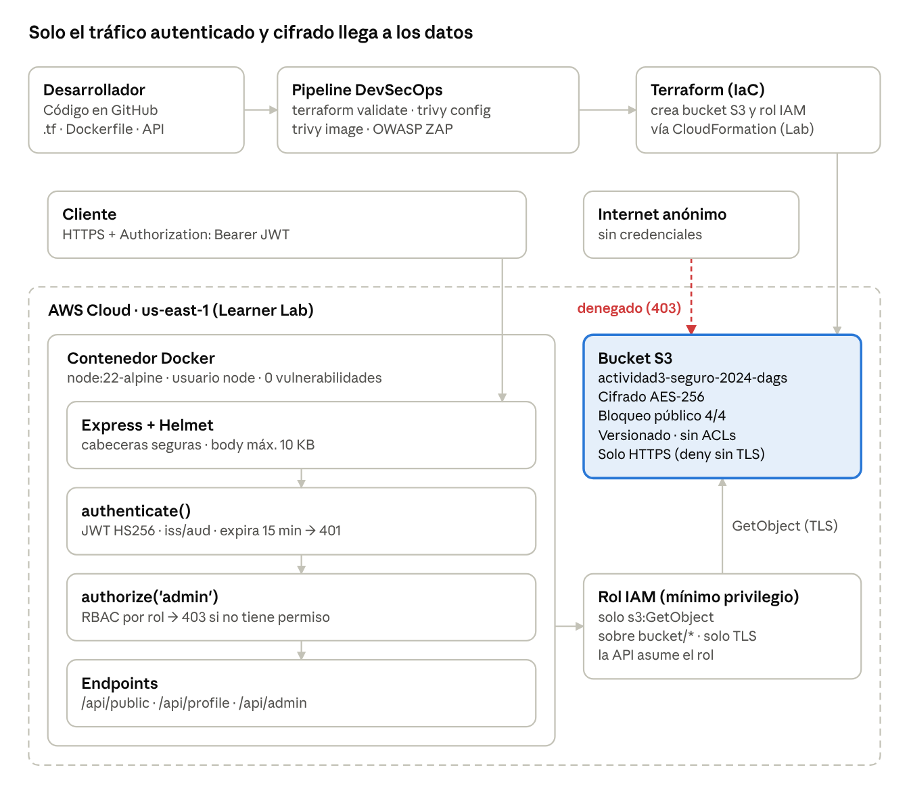

# Actividad 3 – Seguridad en entornos cloud (IaC, contenedores y JWT)

**Alumno:** Daniel Alejandro González Salazar · **Fecha:** 10 de noviembre de 2026

Prácticas de seguridad aplicadas en tres capas, cada una validada con evidencia:

| Fase | Resultado | Evidencia |
| --- | --- | --- |
| 1 · IaC | Bucket S3 simulado en **LocalStack**: cifrado AES256 + 4 controles de bloqueo público, creado con Terraform (**3 recursos**) | [evidencias-fase1/](evidencias-fase1/) |
| 2 · Contenedores | Imagen Docker final con **0 vulnerabilidades** (node:14 tenía 23 críticas) | [trivy_actividad3-api_seguro.txt](reportes/trivy_actividad3-api_seguro.txt) |
| 3 · Desarrollo seguro | API JWT: **7/7** pruebas de autenticación/autorización · OWASP ZAP **120 PASS, 0 FAIL** | [pruebas_jwt.txt](reportes/pruebas_jwt.txt) · [zap_reporte.html](reportes/zap_reporte.html) |

>  **Nada de la Fase 1 apunta a AWS real.** Todo corre en un contenedor LocalStack en `localhost`, con credenciales ficticias. No se requiere cuenta AWS.

## Índice

1. [Fase 1. Bucket S3 seguro con Terraform y LocalStack](#fase-1-bucket-s3-seguro-con-terraform-y-localstack)
2. [Política de IAM](#política-de-iam-de-mínimo-privilegio)
3. [Fase 2. Seguridad de contenedores](#fase-2-seguridad-de-contenedores)
4. [Fase 3. Desarrollo seguro y autenticación](#fase-3-desarrollo-seguro-y-autenticación)
5. [Diagrama de arquitectura](#diagrama-de-arquitectura)
6. [Conclusiones](#conclusiones)
7. [Estructura del repositorio](#estructura-del-repositorio)
8. [Referencias](#referencias)

---

## Fase 1. Bucket S3 seguro con Terraform y LocalStack

**Propósito:** construir un bucket S3 simulado con Terraform, declarar cifrado AES-256 y los controles de bloqueo de acceso público, y verificar qué está realmente configurado.

| Parámetro | Valor |
| --- | --- |
| Bucket | `actividad3-seguro-local` |
| Región | `us-east-1` |
| Endpoint | `http://localhost:4566` |
| Cifrado | SSE-S3 · AES256 |
| Plan Terraform | 3 recursos |
| Acceso público | 4 controles de bloqueo |

```
Terraform  ──►  LocalStack :4566 (contenedor Docker, solo localhost)  ──►  Bucket S3
(código)                                                                  · cifrado AES256
                                                                          · bloqueo público ×4
```

### Requisitos

| Herramienta | Uso | Versión usada |
| --- | --- | --- |
| Docker Desktop | Ejecutar contenedores | 29.2.1 |
| Docker Compose v2 | Levantar LocalStack | v5.1.0 |
| Terraform | Definir y aplicar IaC | 1.17.1 (provider AWS 5.100.0) |
| AWS CLI v2 | Consultar el S3 simulado | 2.34.16 |
| LocalStack (plan **Hobby — Free**) | Emular S3 localmente | 2026.10.6 |

Se necesita una cuenta gratuita en [localstack.cloud](https://www.localstack.cloud/pricing) (LocalStack for AWS → **Hobby — Free**) y su **Auth Token**. El token es un secreto: va solo en un archivo `.env` local que **está en `.gitignore`**.

**Plan Hobby — Free seleccionado y activo** (capturas sin datos de cuenta ni token):

| Página de precios: LocalStack for AWS → Hobby | Cuenta: suscripción activa Hobby (AWS) |
| --- | --- |
|  |  |

En Billing, **"IAM policy enforcement" aparece como función del plan Base**, no del Hobby. Esto explica el resultado del paso 10: con el plan Hobby, LocalStack no aplica la autorización de IAM.

### Instrucciones de ejecución

```bash
# 0. Clonar el repositorio
git clone https://github.com/danny-svj/actividad3-seguridad-cloud.git
cd actividad3-seguridad-cloud

# 1. Token de LocalStack (NO se sube a Git)
cp .env.example .env          # pega tu token en LOCALSTACK_AUTH_TOKEN=

# 2. Fase A · Levantar LocalStack y comprobar salud
docker compose up -d
docker compose ps             # debe decir (healthy)
curl -s http://localhost:4566/_localstack/health

# 3. Fase B · Terraform
terraform init
terraform validate
terraform plan                # Plan: 3 to add
terraform apply

# 4. Fase C · Comprobar con AWS CLI (credenciales ficticias + endpoint local)
export AWS_ACCESS_KEY_ID=test AWS_SECRET_ACCESS_KEY=test AWS_DEFAULT_REGION=us-east-1
E=http://localhost:4566; B=actividad3-seguro-local
aws --endpoint-url $E s3api list-buckets
aws --endpoint-url $E s3api get-bucket-encryption --bucket $B
aws --endpoint-url $E s3api get-public-access-block --bucket $B
aws --endpoint-url $E s3 cp prueba.txt s3://$B/prueba.txt
aws --endpoint-url $E s3 ls s3://$B/
aws --endpoint-url $E s3 cp s3://$B/prueba.txt - --no-sign-request   # acceso anónimo
aws --endpoint-url $E s3api get-bucket-policy-status --bucket $B

# 5. Limpieza
terraform destroy && docker compose down
```

### Fase A · Docker Compose ([compose.yaml](compose.yaml))

```yaml
# LocalStack (plan Hobby) para simular S3 solo en esta computadora.
# El token se lee de la variable LOCALSTACK_AUTH_TOKEN (archivo .env local, excluido de Git).
services:
  localstack:
    container_name: localstack-actividad3
    image: localstack/localstack:2026.10.6
    ports:
      - "127.0.0.1:4566:4566"          # solo localhost, no expuesto a la red
    environment:
      - SERVICES=s3,sts                 # S3 + STS (STS permite a Terraform confirmar la cuenta simulada 000000000000)
      - LOCALSTACK_AUTH_TOKEN=${LOCALSTACK_AUTH_TOKEN:?Define LOCALSTACK_AUTH_TOKEN en .env}
      - AWS_DEFAULT_REGION=us-east-1
    volumes:
      - localstack-data:/var/lib/localstack
    healthcheck:
      # La imagen no incluye curl; se usa Python, que sí trae.
      test: ["CMD", "python3", "-c", "import urllib.request; urllib.request.urlopen('http://localhost:4566/_localstack/health', timeout=4)"]
      interval: 10s
      timeout: 5s
      retries: 10
      start_period: 15s
    restart: unless-stopped

volumes:
  localstack-data:
```

- El puerto se publica **solo en `127.0.0.1`**: nadie en la red puede alcanzar el simulador.
- El token llega por variable de entorno desde `.env`; si falta, Compose se detiene con un mensaje.
- La imagen de LocalStack ya no incluye `curl`, por eso el healthcheck usa Python.
- Se habilita `sts` además de `s3` para que Terraform confirme que habla con la cuenta simulada `000000000000` (ver candado abajo).

**Contenedor saludable** ([02_localstack_saludable.txt](evidencias-fase1/02_localstack_saludable.txt)):

```
$ docker compose ps
NAME                    IMAGE                             STATUS                    PORTS
localstack-actividad3   localstack/localstack:2026.10.6   Up 12 seconds (healthy)   127.0.0.1:4566->4566/tcp

$ curl -s http://localhost:4566/_localstack/health
{
  "services": {
    "s3": "available",
    "sts": "available"
  },
  "edition": "pro",
  "version": "2026.10.6"
}
```

### Fase B · Terraform

**[providers.tf](providers.tf)** — provider apuntando solo a LocalStack:

```hcl
terraform {
  required_version = ">= 1.5"
  required_providers {
    aws = {
      source  = "hashicorp/aws"
      version = "~> 5.0"
    }
  }
}

# Provider apuntando EXCLUSIVAMENTE a LocalStack en localhost.
provider "aws" {
  region     = "us-east-1"
  access_key = "test" # credenciales ficticias que acepta LocalStack
  secret_key = "test"

  # Candado: LocalStack usa la cuenta 000000000000. Si por error se apuntara a
  # AWS real, la cuenta no coincidiría y Terraform se detendría antes de crear nada.
  allowed_account_ids = ["000000000000"]

  skip_credentials_validation = true
  skip_metadata_api_check     = true
  s3_use_path_style           = true

  endpoints {
    s3  = "http://localhost:4566"
    sts = "http://localhost:4566"
  }
}
```

> 🔒 **Candado contra AWS real:** `allowed_account_ids = ["000000000000"]`. Si por error las credenciales o el endpoint apuntaran a AWS real, el ID de cuenta no coincidiría y Terraform abortaría antes de crear nada.

**[main.tf](main.tf)** — bucket, cifrado y los cuatro controles:

```hcl
variable "bucket_name" {
  description = "Nombre del bucket simulado"
  type        = string
  default     = "actividad3-seguro-local"
}

# Recurso 1: bucket S3
resource "aws_s3_bucket" "secure_bucket" {
  bucket = var.bucket_name

  tags = {
    Proyecto = "Actividad3-Seguridad"
    Entorno  = "LocalStack"
  }
}

# Recurso 2: cifrado del lado del servidor SSE-S3 (AES-256)
resource "aws_s3_bucket_server_side_encryption_configuration" "secure_bucket" {
  bucket = aws_s3_bucket.secure_bucket.id

  rule {
    apply_server_side_encryption_by_default {
      sse_algorithm = "AES256"
    }
  }
}

# Recurso 3: los cuatro controles de bloqueo de acceso público
resource "aws_s3_bucket_public_access_block" "secure_bucket" {
  bucket = aws_s3_bucket.secure_bucket.id

  block_public_acls       = true # rechaza nuevas ACL públicas
  ignore_public_acls      = true # ignora ACL públicas existentes
  block_public_policy     = true # rechaza políticas de bucket públicas
  restrict_public_buckets = true # limita el acceso si hubiera una política pública
}

output "bucket_name" {
  value = aws_s3_bucket.secure_bucket.id
}
```

**Validación y plan** ([03](evidencias-fase1/03_terraform_validate.txt) · [04](evidencias-fase1/04_terraform_plan.txt)):

```
$ terraform validate
Success! The configuration is valid.

$ terraform plan
  # aws_s3_bucket.secure_bucket will be created
  # aws_s3_bucket_public_access_block.secure_bucket will be created
  # aws_s3_bucket_server_side_encryption_configuration.secure_bucket will be created
Plan: 3 to add, 0 to change, 0 to destroy.
```

**Aplicación** ([05_terraform_apply.txt](evidencias-fase1/05_terraform_apply.txt)):

```
aws_s3_bucket.secure_bucket: Creation complete after 0s [id=actividad3-seguro-local]
aws_s3_bucket_public_access_block.secure_bucket: Creation complete after 0s [id=actividad3-seguro-local]
aws_s3_bucket_server_side_encryption_configuration.secure_bucket: Creation complete after 0s [id=actividad3-seguro-local]
Apply complete! Resources: 3 added, 0 changed, 0 destroyed.

$ terraform state list
aws_s3_bucket.secure_bucket
aws_s3_bucket_public_access_block.secure_bucket
aws_s3_bucket_server_side_encryption_configuration.secure_bucket
```

### Fase C · Comprobaciones con AWS CLI

| Paso | Comprobación | Resultado |
| --- | --- | --- |
| 8 | `list-buckets` | `actividad3-seguro-local` ✅ |
| 8 | `get-bucket-encryption` | `SSEAlgorithm: AES256` ✅ |
| 8 | `get-public-access-block` | Los 4 controles en `true` ✅ |
| 9 | Subir `prueba.txt` y listar | Aparece en el listado (59 bytes, cifrado `AES256`) ✅ |
| 10 | Descarga anónima (`--no-sign-request` y `curl`) | **Permitida (HTTP 200)** ⚠️ limitación del simulador |
| 11 | `get-bucket-policy-status` | `NoSuchBucketPolicy` (no hay política) ℹ️ |

<details>
<summary><b>Paso 8 · Salida completa</b> (<a href="evidencias-fase1/06_consultas_cifrado_bloqueo.txt">06_consultas_cifrado_bloqueo.txt</a>)</summary>

```
# Variables usadas (credenciales ficticias de LocalStack):
# export AWS_ACCESS_KEY_ID=test AWS_SECRET_ACCESS_KEY=test AWS_DEFAULT_REGION=us-east-1

## Paso 8 · Buckets, cifrado y bloqueo de acceso público
$ aws --endpoint-url http://localhost:4566 s3api list-buckets --query Buckets[].Name
[
    "actividad3-seguro-local"
]

$ aws --endpoint-url http://localhost:4566 s3api get-bucket-encryption --bucket actividad3-seguro-local
{
    "ServerSideEncryptionConfiguration": {
        "Rules": [
            {
                "ApplyServerSideEncryptionByDefault": {
                    "SSEAlgorithm": "AES256"
                },
                "BucketKeyEnabled": false,
                "BlockedEncryptionTypes": {
                    "EncryptionType": [
                        "SSE-C"
                    ]
                }
            }
        ]
    }
}

$ aws --endpoint-url http://localhost:4566 s3api get-public-access-block --bucket actividad3-seguro-local
{
    "PublicAccessBlockConfiguration": {
        "BlockPublicAcls": true,
        "IgnorePublicAcls": true,
        "BlockPublicPolicy": true,
        "RestrictPublicBuckets": true
    }
}

```
</details>

<details>
<summary><b>Pasos 9 y 10 · Carga y acceso anónimo</b> (<a href="evidencias-fase1/07_carga_y_acceso_anonimo.txt">07_carga_y_acceso_anonimo.txt</a>)</summary>

```
## Paso 9 · Carga de archivo de prueba
$ cat prueba.txt
Archivo de prueba de la Actividad 3 - 2026-11-10T23:41:15Z

$ aws --endpoint-url http://localhost:4566 s3 cp prueba.txt s3://actividad3-seguro-local/prueba.txt
Completed 59 Bytes/59 Bytes (672 Bytes/s) with 1 file(s) remaining
upload: ./prueba.txt to s3://actividad3-seguro-local/prueba.txt   

$ aws --endpoint-url http://localhost:4566 s3 ls s3://actividad3-seguro-local/
2026-11-10 17:41:15         59 prueba.txt

$ aws --endpoint-url http://localhost:4566 s3api head-object --bucket actividad3-seguro-local --key prueba.txt --query {Tamano:ContentLength,Cifrado:ServerSideEncryption}
{
    "Tamano": 59,
    "Cifrado": "AES256"
}

## Paso 10 · Intento de descarga anónima (sin firmar)
$ aws --endpoint-url http://localhost:4566 s3 cp s3://actividad3-seguro-local/prueba.txt descarga_anonima.txt --no-sign-request
Completed 59 Bytes/59 Bytes (3.6 KiB/s) with 1 file(s) remaining
download: s3://actividad3-seguro-local/prueba.txt to ./descarga_anonima.txt

$ curl -s -w '\nHTTP %{http_code}\n' http://localhost:4566/actividad3-seguro-local/prueba.txt
Archivo de prueba de la Actividad 3 - 2026-11-10T23:41:15Z

HTTP 200

```
</details>

<details>
<summary><b>Paso 11 · Estado de la política</b> (<a href="evidencias-fase1/08_policy_status.txt">08_policy_status.txt</a>)</summary>

```
## Paso 11 · Estado de la política del bucket
$ aws --endpoint-url http://localhost:4566 s3api get-bucket-policy-status --bucket actividad3-seguro-local

aws: [ERROR]: An error occurred (NoSuchBucketPolicy) when calling the GetBucketPolicyStatus operation: The bucket policy does not exist

Additional error details:
BucketName: actividad3-seguro-local

$ aws --endpoint-url http://localhost:4566 s3api get-bucket-policy --bucket actividad3-seguro-local

aws: [ERROR]: An error occurred (NoSuchBucketPolicy) when calling the GetBucketPolicy operation: The bucket policy does not exist

Additional error details:
BucketName: actividad3-seguro-local

```
</details>

#### Interpretación del paso 10: acceso anónimo permitido

LocalStack **aceptó la descarga sin firmar** aunque el bucket tiene los 4 controles de bloqueo público. Esto se trata como **limitación del simulador**, no como exposición real:

- LocalStack, por defecto, **no evalúa autorización** (IAM ni políticas de recursos; la opción `ENFORCE_IAM` viene desactivada). Su objetivo es emular las API de AWS para desarrollo, no replicar todo el modelo de permisos.
- En el plan **Hobby** la aplicación de políticas IAM (*IAM policy enforcement*) ni siquiera está incluida: es función del plan Base (ver captura de Billing arriba).
- El bloqueo de acceso público sí quedó **declarado y consultable** (paso 8), pero el simulador no lo **aplica** a las solicitudes.
- Además, el puerto está publicado solo en `127.0.0.1`, así que nadie fuera de esta computadora puede alcanzarlo.
- **Validación independiente:** en una prueba previa en AWS real (AWS Academy Learner Lab) con la misma configuración, el acceso anónimo fue **rechazado con HTTP 403** ([referencia-aws-real/validacion_s3_learnerlab.txt](reportes/referencia-aws-real/validacion_s3_learnerlab.txt)).

#### Interpretación del paso 11: `NoSuchBucketPolicy`

Significa que el bucket **no tiene política de bucket** asociada; no es una confirmación de exposición pública. `get-bucket-policy-status` solo evalúa si una política existente es pública. Sin política no hay nada que la haga pública, y con los 4 controles en `true` cualquier política pública futura sería rechazada (`BlockPublicPolicy`) o neutralizada (`RestrictPublicBuckets`).

### Dashboard de LocalStack

En [app.localstack.cloud](https://app.localstack.cloud) → **Resource Browser → S3**, con el endpoint `http://localhost:4566`, se localiza el bucket `actividad3-seguro-local`, el archivo `prueba.txt` y su configuración de cifrado.



La instancia aparece en verde en `localhost.localstack.cloud:4566`, con la cuenta simulada `000000000000`, y el bucket contiene `prueba.txt` (59 bytes), el mismo archivo subido en el paso 9.

### Conclusión de la Fase 1: declarado vs. consultado vs. aplicado

| Nivel | Qué es | Evidencia en esta práctica |
| --- | --- | --- |
| **Infraestructura declarada** | Lo que el código *dice* que debe existir | `main.tf`: bucket + AES256 + 4 bloqueos → `Plan: 3 to add` |
| **Configuración consultada** | Lo que el servicio *reporta* que tiene | AWS CLI: `AES256` y los 4 controles en `true` |
| **Seguridad aplicada** | Lo que *realmente ocurre* ante una solicitud | Descarga anónima **permitida** en LocalStack; **denegada (403)** en AWS real |

Que algo esté declarado y aparezca en la configuración no prueba que se aplique. La seguridad se confirma con pruebas de comportamiento, y en un simulador esas pruebas necesitan una validación independiente en el entorno real.

### Criterios de seguridad cumplidos

- ✅ Token de LocalStack solo en `.env` local, excluido por `.gitignore` (junto con `*.tfstate`, `.terraform/` y credenciales).
- ✅ Credenciales ficticias (`test`/`test`); ninguna información confidencial real.
- ✅ Ningún comando apunta a AWS: endpoint `localhost:4566` + candado `allowed_account_ids`.
- ✅ El acceso anónimo aceptado por LocalStack se documenta como limitación del simulador, contrastado con AWS real.

---

## Política de IAM de mínimo privilegio

La aplicación solo recibe `s3:GetObject` sobre los objetos de su bucket y solo por HTTPS. No puede listar, escribir, borrar ni tocar otros buckets. La política se asocia a un rol que la aplicación asume, nunca a usuarios con llaves fijas ([iam/iam-policy.json](iam/iam-policy.json)):

```json
{
  "Version": "2012-10-17",
  "Statement": [
    {
      "Sid": "AllowReadObjectsOnly",
      "Effect": "Allow",
      "Action": ["s3:GetObject"],
      "Resource": "arn:aws:s3:::actividad3-seguro-local/*",
      "Condition": {
        "Bool": { "aws:SecureTransport": "true" }
      }
    }
  ]
}
```

---

## Fase 2. Seguridad de contenedores

La imagen final de la API (`actividad3-api:seguro`, basada en `node:22-alpine`) tiene **0 vulnerabilidades de cualquier severidad**. La imagen obsoleta `node:14` tenía 23 críticas. Al día del escaneo, `node:18` (la que propone la guía) también está fuera de soporte desde abril de 2025 y sale peor que node:14, por eso se usó Node 22 LTS.

### Comparativa de escaneos (`trivy image`)

| Imagen | Críticas | Altas | Medias | Bajas |
| --- | ---: | ---: | ---: | ---: |
| node:14 (obsoleta) | 23 | 572 | 735 | 122 |
| node:18 (propuesta por la guía) | 228 | 2302 | 6778 | 2725 |
| node:18-alpine | 3 | 43 | 55 | 38 |
| node:22-alpine (base limpia) | 0 | 10 | 13 | 1 |
| **actividad3-api:seguro (imagen final)** | **0** | **0** | **0** | **0** |

Detalle de CVEs críticos por imagen: [trivy_resumen_comparativo.txt](reportes/trivy_resumen_comparativo.txt). Ejemplos en node:14: CVE-2024-32002 (RCE en git), CVE-2023-38408 (RCE en ssh-agent de OpenSSH), CVE-2023-45853 (desbordamiento en zlib), CVE-2021-3177 (desbordamiento de pila en Python 2.7).

### Dockerfile inseguro ([docker/inseguro/Dockerfile](docker/inseguro/Dockerfile))

```dockerfile
# Imagen base OBSOLETA (Node 14, fin de soporte abril 2023) - solo para demostrar vulnerabilidades
FROM node:14
WORKDIR /app
COPY . .
EXPOSE 3000
CMD ["node", "-e", "require('http').createServer((q,s)=>s.end('ok')).listen(3000)"]
```

### Dockerfile actualizado y endurecido ([api/Dockerfile](api/Dockerfile))

```dockerfile
# Imagen ACTUALIZADA y mínima (Alpine, Node 22 LTS) - build multi-etapa
FROM node:22-alpine AS deps
WORKDIR /app
COPY package*.json ./
RUN npm ci --omit=dev && npm cache clean --force

FROM node:22-alpine
# Aplica parches de seguridad del SO y elimina npm/yarn/corepack (no se usan en runtime)
RUN apk upgrade --no-cache \
 && rm -rf /usr/local/lib/node_modules /usr/local/bin/npm /usr/local/bin/npx \
           /usr/local/bin/corepack /usr/local/bin/yarn /usr/local/bin/yarnpkg /opt/yarn*
ENV NODE_ENV=production
WORKDIR /app
COPY --from=deps --chown=node:node /app/node_modules ./node_modules
COPY --chown=node:node package.json auth.js server.js ./
# No ejecutar como root
USER node
EXPOSE 3000
HEALTHCHECK CMD wget -qO- http://localhost:3000/api/public || exit 1
CMD ["node", "server.js"]
```

### Mitigaciones aplicadas

1. **Base actualizada y mínima:** de Debian `node:14` a `node:22-alpine`.
2. **Build en dos etapas:** solo dependencias de producción (`npm ci --omit=dev`) llegan a la imagen final.
3. **Parches del SO:** `apk upgrade` al construir.
4. **Sin herramientas sobrantes:** se quitaron npm, yarn y corepack, origen de las 10 vulnerabilidades altas restantes.
5. **Usuario sin privilegios:** el contenedor corre como `node` (verificado con `docker exec actividad3-api whoami` → `node`).
6. **Sin secretos en la imagen:** `JWT_SECRET` por variable de entorno; `.dockerignore` excluye `.env` y `node_modules`.

### Reporte de Trivy de la imagen final

```
$ trivy image actividad3-api:seguro
┌────────────────────────────────────────────┬──────────┬─────────────────┐
│ Target                                     │   Type   │ Vulnerabilities │
├────────────────────────────────────────────┼──────────┼─────────────────┤
│ actividad3-api:seguro (alpine 3.24.4)      │  alpine  │        0        │
│ app/node_modules/express/package.json      │ node-pkg │        0        │
│ app/node_modules/jsonwebtoken/package.json │ node-pkg │        0        │
│ app/node_modules/helmet/package.json       │ node-pkg │        0        │
│ ... (resto de dependencias)                │ node-pkg │        0        │
└────────────────────────────────────────────┴──────────┴─────────────────┘
```

Reporte completo: [trivy_actividad3-api_seguro.txt](reportes/trivy_actividad3-api_seguro.txt).

`trivy config` del Dockerfile inseguro reportó 2 fallas: **DS-0002** (HIGH, corre como root) y **DS-0026** (LOW, sin HEALTHCHECK). El Dockerfile seguro: 0 fallas.

---

## Fase 3. Desarrollo seguro y autenticación

La API valida un JWT en cada endpoint sensible y el rol en `/api/admin`. Las 7 pruebas dieron el resultado esperado y OWASP ZAP terminó con **120 PASS, 0 FAIL, 0 WARN**.

### Middleware de autenticación JWT ([api/auth.js](api/auth.js))

```javascript
// Middleware de autenticación y autorización JWT
const jwt = require('jsonwebtoken');

const JWT_SECRET = process.env.JWT_SECRET;
if (!JWT_SECRET || JWT_SECRET.length < 32) {
  throw new Error('JWT_SECRET debe definirse por variable de entorno (mín. 32 caracteres)');
}

const VERIFY_OPTIONS = {
  algorithms: ['HS256'],      // evita ataques "alg: none" / confusión de algoritmo
  issuer: 'actividad3-api',
  audience: 'actividad3-clientes',
};

// Autenticación: valida que exista un token Bearer válido y vigente
function authenticate(req, res, next) {
  const header = req.headers.authorization || '';
  const [scheme, token] = header.split(' ');
  if (scheme !== 'Bearer' || !token) {
    return res.status(401).json({ error: 'Token requerido' });
  }
  try {
    req.user = jwt.verify(token, JWT_SECRET, VERIFY_OPTIONS);
    return next();
  } catch (err) {
    // No se revela el motivo exacto al cliente
    return res.status(401).json({ error: 'Token inválido o expirado' });
  }
}

// Autorización: valida que el rol del usuario esté permitido (RBAC)
function authorize(...rolesPermitidos) {
  return (req, res, next) => {
    if (!req.user || !rolesPermitidos.includes(req.user.role)) {
      return res.status(403).json({ error: 'Permisos insuficientes' });
    }
    return next();
  };
}

function signToken(user) {
  return jwt.sign({ sub: user.username, role: user.role }, JWT_SECRET, {
    algorithm: 'HS256',
    expiresIn: '15m',
    issuer: VERIFY_OPTIONS.issuer,
    audience: VERIFY_OPTIONS.audience,
  });
}

module.exports = { authenticate, authorize, signToken };
```

### Uso en los endpoints ([api/server.js](api/server.js), extracto)

```javascript
app.use(helmet());                         // cabeceras de seguridad HTTP
app.use(express.json({ limit: '10kb' }));  // limita tamaño del body

app.get('/api/public', (req, res) => res.json({ mensaje: 'Endpoint público' }));

app.get('/api/profile', authenticate, (req, res) =>
  res.json({ usuario: req.user.sub, rol: req.user.role }));

app.get('/api/admin', authenticate, authorize('admin'), (req, res) =>
  res.json({ mensaje: 'Panel de administración', usuario: req.user.sub }));
```

### Controles de desarrollo seguro

- Solo se acepta HS256: un token con `alg: none` se rechaza.
- Se validan emisor (`iss`), audiencia (`aud`) y expiración (15 minutos).
- El secreto viene de una variable de entorno (mín. 32 caracteres); la API no arranca sin él.
- Errores genéricos que no revelan por qué falló el token.
- 401 = no autenticado; 403 = autenticado sin permiso.
- Helmet, `X-Powered-By` oculto y body limitado a 10 KB.
- `npm audit`: 0 vulnerabilidades.

### Pruebas de autenticación y autorización ([api/test.js](api/test.js))

| Prueba | Esperado | Obtenido | Resultado |
| --- | :---: | :---: | :---: |
| GET /api/public sin token | 200 | 200 | ✅ PASS |
| GET /api/admin sin token | 401 | 401 | ✅ PASS |
| GET /api/admin con token firmado con otro secreto | 401 | 401 | ✅ PASS |
| GET /api/admin con token `alg=none` | 401 | 401 | ✅ PASS |
| GET /api/admin con rol user | 403 | 403 | ✅ PASS |
| GET /api/admin con rol admin | 200 | 200 | ✅ PASS |
| GET /api/profile con rol user | 200 | 200 | ✅ PASS |

### Escaneo con OWASP ZAP

Se usó `zap-api-scan.py` con una definición OpenAPI ([api/openapi.json](api/openapi.json)) de los 4 endpoints, que declara el esquema Bearer JWT. Corrió reglas pasivas y activas: inyección SQL y de comandos, path traversal, XXE, SSTI, autenticación débil, divulgación de errores, entre otras.

```
$ docker run --rm -v ./reportes:/zap/wrk ghcr.io/zaproxy/zaproxy:stable \
    zap-api-scan.py -t /zap/wrk/openapi.json -f openapi -r zap_reporte.html
...
PASS: Weak Authentication Method [10105]
PASS: Authentication Request Identified [10111]
PASS: Application Error Disclosure [90022]
PASS: Remote OS Command Injection [90020]
...
FAIL-NEW: 0  FAIL-INPROG: 0  WARN-NEW: 0  WARN-INPROG: 0  INFO: 0  IGNORE: 0  PASS: 120
```

ZAP accedió a los endpoints protegidos sin token y recibió 401 en todos: no encontró fallas de validación de tokens ni de permisos. Reporte completo: [zap_reporte.html](reportes/zap_reporte.html) · [salida completa](reportes/zap_salida.txt).

---

## Diagrama de arquitectura

Todo corre en local: Terraform declara el bucket en LocalStack (solo en `127.0.0.1:4566`) y la API exige JWT y rol antes de responder.



Versión editable en draw.io: [diagrama/arquitectura-segura.drawio](diagrama/arquitectura-segura.drawio) (abrir en [app.diagrams.net](https://app.diagrams.net) → Archivo → Abrir).

---

## Conclusiones

- **Declarar no es lo mismo que aplicar.** Terraform y AWS CLI confirman que el cifrado y los 4 bloqueos están configurados, pero LocalStack dejó pasar una descarga anónima. Solo una prueba de comportamiento en el entorno real (403 en AWS) confirma que el control funciona.
- **"Actualizar" no siempre es suficiente.** Node 18 ya llegó a fin de soporte y tenía más vulnerabilidades que Node 14. Lo que llevó la imagen a 0 fue combinar una versión LTS vigente, base mínima (Alpine), build en dos etapas y quitar herramientas que no se usan.
- **Autenticar no es autorizar.** Validar el JWT (401) y validar el rol (403) son controles distintos; las pruebas con token falsificado y `alg=none` confirman que la validación no se puede saltar.

## Estructura del repositorio

```
compose.yaml            Fase 1 · LocalStack (S3) solo en localhost
providers.tf            Fase 1 · provider AWS → LocalStack, credenciales ficticias, candado de cuenta
main.tf                 Fase 1 · bucket + cifrado AES256 + 4 bloqueos (3 recursos)
.env.example            Plantilla para el token (el .env real NO se sube)
prueba.txt              Archivo de prueba subido al bucket
evidencias-fase1/       Versiones, salud, validate/plan/apply y consultas AWS CLI
iam/iam-policy.json     Política IAM de mínimo privilegio (solo s3:GetObject)
docker/inseguro/        Fase 2 · Dockerfile con imagen obsoleta (node:14)
docker/seguro/          Fase 2 · Dockerfile actualizado y endurecido
api/                    Fase 3 · API Express con middleware JWT, pruebas, OpenAPI y Dockerfile
diagrama/               Diagrama de arquitectura (PNG y draw.io)
reportes/               Trivy, OWASP ZAP, pruebas JWT y referencia en AWS real
```

## Referencias

- LocalStack. (2026). *LocalStack for AWS – Pricing*. https://www.localstack.cloud/pricing
- LocalStack. (2026). *LocalStack Docs*. https://docs.localstack.cloud
- Terraform. (s.f.). *Install Terraform*. https://developer.hashicorp.com/terraform/install
- Docker. (2025). *Docker: Accelerated Container Application Development*. https://www.docker.com
- Aqua Security. (2025). *Trivy: Simple and Comprehensive Vulnerability Scanner for Containers*. https://trivy.dev
- OWASP Foundation. (2025). *ZAP: Zed Attack Proxy*. https://www.zaproxy.org
